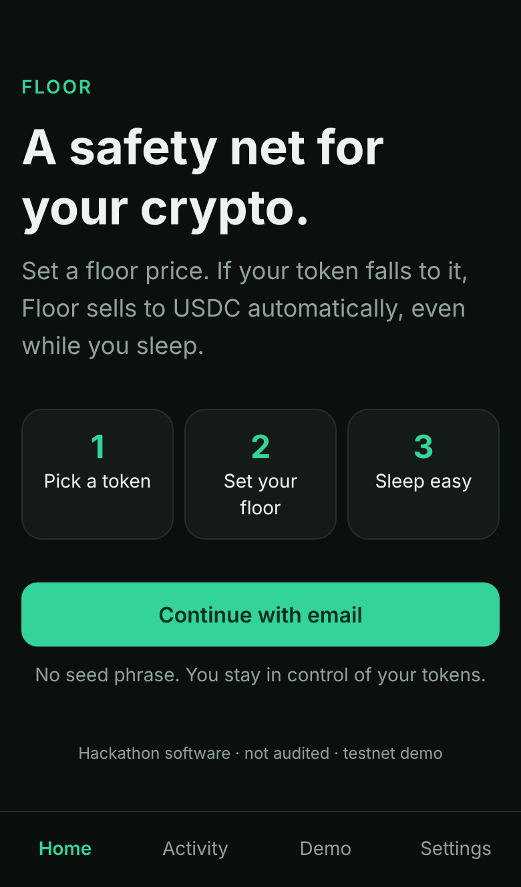
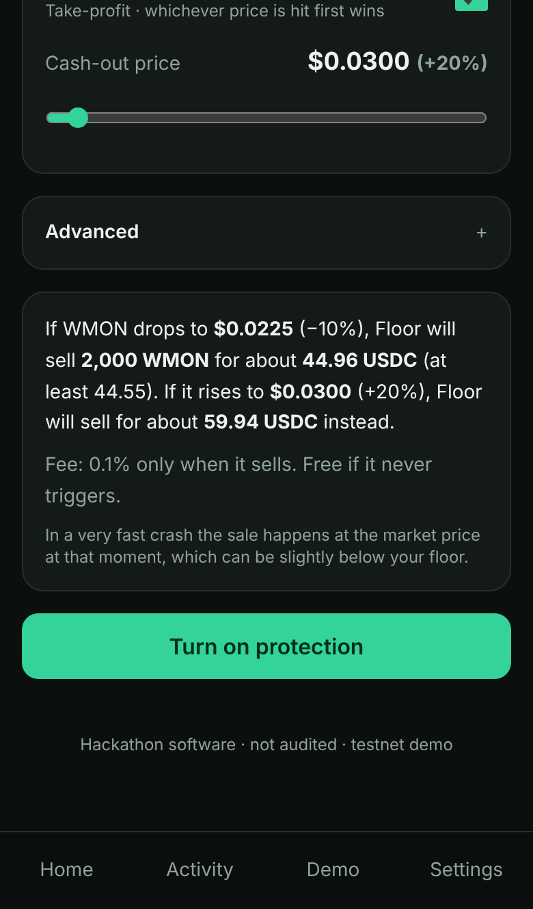
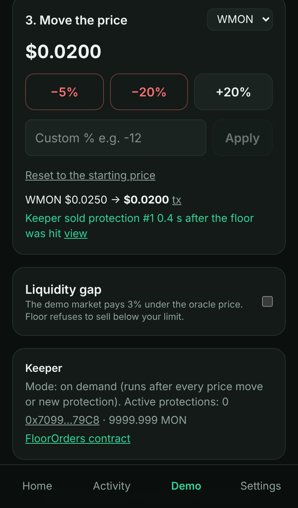
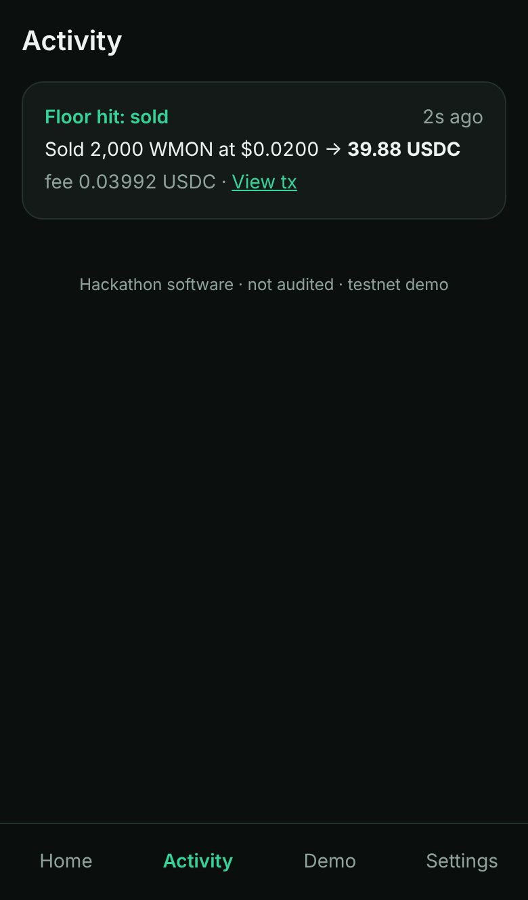
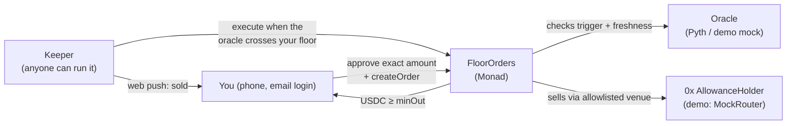

# Floor

**A safety net for crypto holders on Monad.** Set a price floor on a token you hold. If the
price falls to it, Floor sells to USDC automatically, even while you sleep. You can also set a
cash-out price to lock in profit, and whichever price is hit first wins.

> ⚠️ **Hackathon software. Not audited.** Built for the Monad Metropolis Hackathon (Onchain
> Finance & Trading). Testnet demo; use tiny amounts only.

<p>
  
  
  
  
</p>

## The problem

Tunde holds $300 of MON. At 3am it drops 25% while he's asleep. Exchanges have stop-losses,
but onchain, self-custody holders have nothing that watches their wallet for them. The tools
that exist (order books, trading terminals) are built for traders, not for someone with $50–$500
on a phone.

## What Floor does

1. **Sign in with email.** No seed phrase: Privy creates an embedded wallet.
2. **Pick a token and set a floor** with one slider (default −10%). Optionally, cash out if it
   goes up (default +20%). Floor shows a plain-English summary: _"If WMON drops to $0.0225,
   Floor will sell 2,000 WMON for about 44.96 USDC (at least 44.55)."_
3. **Approve the exact amount and turn it on.** Your tokens stay in your wallet.
4. **When the price crosses your floor, Floor sells** to USDC, typically under a second later
   on Monad, and sends a push notification with the receipt.

**Fee:** 0.1% of the sale, only when a protection sells. Free if it never triggers.

## Proof it works

| What                   | Evidence                                                                                                                                                                                                                                   |
| ---------------------- | ------------------------------------------------------------------------------------------------------------------------------------------------------------------------------------------------------------------------------------------ |
| Contracts on testnet   | 7 contracts deployed and verified on Monad testnet (10143). FloorOrders: [`0x940Bc18D…3Aef`](https://testnet.monadvision.com/address/0x940Bc18DEf074037D4D31966b732421986193Aef). All addresses: [`docs/addresses.md`](docs/addresses.md). |
| Keeper speed           | On Monad testnet, the keeper filled a protected order **474 ms after the crash confirmed** ([fill tx](https://testnet.monadvision.com/tx/0xb9dc49f709ad033b40f45e05768f68bbdc3f2308c35b5bd26664ad96ceda7fab)).                             |
| Mainnet readiness      | `DeployLive` rehearsed on a Monad mainnet fork with real Pyth prices for all four feeds, plus create/cancel with real WMON. Fork tests in `contracts/test/Deploy.t.sol`.                                                                   |
| Tests                  | 75 Foundry tests (unit, fuzz, invariants, hostile venues, mainnet fork), 300 shared math vectors checked in Solidity and TypeScript, 61 vitest tests, 5 Playwright e2e tests including an axe WCAG 2.1 AA audit of every screen.           |
| Lighthouse (mobile, /) | Performance 91 · Accessibility 100 · Best practices 100 · SEO 100.                                                                                                                                                                         |

## How it works



- `FloorOrders` stores protections: token, amount, trigger, max price difference, an optional
  never-sell-below price and expiry. A **bracket** links a floor and a cash-out; when one fills,
  the other is cancelled.
- **Anyone can execute.** The contract re-checks everything itself: oracle freshness and
  confidence, the trigger, the venue allowlist, and that the USDC received reaches
  `minOut = oracle value × (1 − max price difference)`.
- **Our keeper** evaluates every block with the same math as the contract (`@floor/shared`),
  simulates, then sends. On the hosted demo it runs **on demand** inside the app's server
  routes after each price move and each new protection (D-011), so it needs no paid hosting.
  `pnpm keeper:start` runs it always-on for live prices.

Full diagram and fill sequence: [`docs/architecture.md`](docs/architecture.md). Decisions:
[`docs/DECISIONS.md`](docs/DECISIONS.md).

## Trust model

| Question                                   | Answer                                                                                                                                                                                                                                                                          |
| ------------------------------------------ | ------------------------------------------------------------------------------------------------------------------------------------------------------------------------------------------------------------------------------------------------------------------------------- |
| Who holds my tokens?                       | You do. They stay in your wallet until a protection sells. FloorOrders holds nothing between calls (an invariant test checks this).                                                                                                                                             |
| Can the keeper sell early?                 | No. The contract checks the trigger against the oracle itself.                                                                                                                                                                                                                  |
| Can the keeper sell cheap?                 | Only down to your `minOut`, set by your max price difference (default 1%, capped at 5%). Below that the transaction reverts.                                                                                                                                                    |
| Can someone drain my approval?             | Swap venues are allowlisted as (target, spender) pairs, and each fill approves exactly `amountIn` and resets it to 0 in the same transaction.                                                                                                                                   |
| What if the market can't pay a fair price? | The order waits instead of selling below your limit. The `/demo` "liquidity gap" toggle shows this.                                                                                                                                                                             |
| What can the owner do?                     | Pause new orders and fills (cancels always work), set the fee up to a hard 0.5% cap, manage the token and venue allowlists and oracle limits, and **replace the oracle**. No upgradeability and no `delegatecall`.                                                              |
| So what do I trust the owner with?         | The oracle and the venue list. A malicious owner could point FloorOrders at a fake oracle and trigger sales at bad prices. Mitigations on the roadmap: a multisig owner and a timelock on `setOracle` and `setSwapTarget`. Cancelling (or revoking your approval) always works. |
| What if the keeper is down?                | Protections don't fire until someone executes them. Anyone can, and they earn the fee.                                                                                                                                                                                          |

Security details: checks-effects-interactions plus `nonReentrant` on every state-changing entry
point; fills are judged by balance changes, not by what the venue returns; `Ownable2Step`.

## Repo layout

| Path               | What                                                                               |
| ------------------ | ---------------------------------------------------------------------------------- |
| `contracts/`       | Foundry: `FloorOrders`, `PythAdapter`, mocks, deploy and smoke scripts             |
| `keeper/`          | Node/TypeScript keeper (viem): track, evaluate, quote, simulate, send, notify      |
| `app/`             | Next.js 16 PWA: Privy wallet, screens, server routes, web push, Playwright         |
| `packages/shared/` | Chains, token registry, ABIs (generated), trigger and `minOut` math, Pyth helpers  |
| `docs/`            | Architecture, addresses, decisions, deploy/keeper/app runbooks, demo script, pitch |

## Run locally

Requirements: Node ≥ 22.12, pnpm 10.28, Foundry ≥ 1.8.0 (for Monad support).

```bash
git clone --recurse-submodules https://github.com/Emediong-Etuk/floor
cd floor
pnpm install
```

**The whole app on a local chain, no accounts needed.** This starts anvil in Monad mode
(400 ms blocks), deploys the demo contracts, and serves a production build wired to them,
with a local test wallet in place of Privy (allowed only on chain 31337):

```bash
cd app && node e2e/run.mjs --serve     # http://127.0.0.1:3101
```

Then: **Continue with email** → **Demo** → **Mint test tokens** → **Home** → **Protect** →
**Demo** → **−20%**, and watch the keeper sell.

**Against Monad testnet** (the deployed contracts):

```bash
cp app/.env.example app/.env.local     # needs a Privy App ID; see docs/app.md
pnpm app:dev                           # http://localhost:3000
```

### Environment

Each package has an `.env.example`; copy it to a git-ignored `.env` (`.env.local` for the
app). Never commit keys.

| File                     | Key variables                                                                                                          |
| ------------------------ | ---------------------------------------------------------------------------------------------------------------------- |
| `app/.env.example`       | `NEXT_PUBLIC_PRIVY_APP_ID`, `NEXT_PUBLIC_CHAIN_ID`, `DEMO_OPERATOR_PRIVATE_KEY`, `KEEPER_PRIVATE_KEY`, VAPID + Upstash |
| `keeper/.env.example`    | `KEEPER_PRIVATE_KEY`, `RPC_HTTP_URL`, `ZEROX_API_KEY` (live), optional `HERMES_*`, `NOTIFY_URL`                        |
| `contracts/.env.example` | `DEPLOYER_PRIVATE_KEY`, `MONAD_TESTNET_RPC_URL`, `MONAD_MAINNET_RPC_URL`                                               |

Runbooks: [`docs/deploy.md`](docs/deploy.md) (contracts), [`docs/keeper.md`](docs/keeper.md),
[`docs/app.md`](docs/app.md) (including the free Vercel deploy).

### Tests

```bash
pnpm contracts:test     # 75 Foundry tests (fork tests run when MONAD_MAINNET_RPC_URL is set)
pnpm test               # vitest: shared math + vectors, keeper (incl. anvil e2e), app routes and push
pnpm typecheck
pnpm lint               # prettier + forge fmt
pnpm app:e2e            # Playwright on anvil: full lifecycle, edit/cancel, validation, PWA, axe
pnpm contracts:rehearse:local   # deploy + smoke with a real fill on anvil
pnpm e2e:testnet        # testnet: mint → protect → crash → keeper fills (spends testnet MON)
```

CI runs contracts (fmt, build, test, coverage), TypeScript (lint, typecheck, test, build) and
the app e2e on every push.

## Limitations

- **Not audited.** Hackathon software.
- **Testnet demo.** Mainnet contracts and scripts are ready and fork-tested, but not launched.
  Testnet prices come from a mock oracle moved by the `/demo` panel; 0x doesn't support Monad
  testnet, so the demo sells through a mock router.
- **Oracle risk:** live prices come from Pyth (WETH is priced with ETH/USD). Without a Hermes
  key, live mode relies on sponsored push feeds, which update on deviation or hourly (D-004).
- **Liquidity risk:** in a very fast crash the sale happens at the market price at that
  moment, which can be below your floor, but never below your `minOut`. If no venue can pay
  that, the order waits.
- **Keeper liveness:** if nobody executes, protections don't fire. The hosted demo runs the
  keeper on demand (D-011); live prices need an always-on keeper (`pnpm keeper:start`).
- **Owner trust:** the owner can replace the oracle and the venue list (see Trust model). Today
  that's a single key; a multisig and timelock come before mainnet caps go up.
- You need a little MON for gas (the demo faucet sends 0.2 testnet MON).

## Roadmap

1. Mainnet launch with a $500 per-order cap, selling through 0x.
2. Trailing floors that rise with the price.
3. Sponsored gas, so users never need MON.
4. One-tap approve + protect (EIP-7702 or Permit2).
5. A Telegram alerts bot, for the West African community pilot.
6. An embeddable widget so any Monad wallet can offer Floor.
7. A multisig owner and a timelock on oracle and venue changes; an audit before raising caps.
8. An open keeper network and Kuru as a second venue.

Pitch: [`docs/pitch-outline.md`](docs/pitch-outline.md) · Demo script:
[`docs/demo-script.md`](docs/demo-script.md) · Submission checklist:
[`docs/submission.md`](docs/submission.md) · Status: [`PROGRESS.md`](PROGRESS.md)

## License

[MIT](LICENSE)
