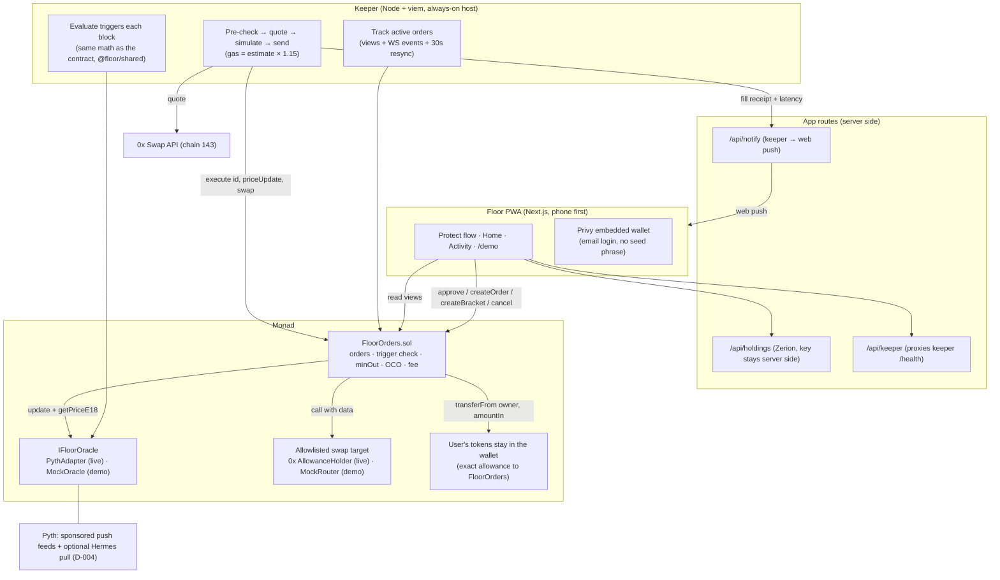

# Architecture

## How a protection fills

1. The user approves the exact amount to `FloorOrders` and creates an order or a bracket. The
   tokens stay in the user's wallet.
2. The keeper sees `OrderCreated` and adds the order to its in-memory set. It re-reads
   `getActiveOrders` every 30 s as a safety net.
3. Each block (~400 ms), the keeper evaluates triggers with the same math as the contract.
4. When an order triggers, the keeper:
   - checks the owner's balance and allowance (Multicall3),
   - gets a 0x quote with `taker = FloorOrders` (live mode),
   - rejects the quote if it's below `minOut`,
   - simulates `execute`, then sends it with a tight gas limit (Monad charges the limit, not
     the gas used).
5. `execute` re-checks everything onchain:
   - oracle freshness and confidence,
   - the trigger,
   - the target and spender allowlist,
   - `received ≥ minOut`.

   It marks the order filled (and cancels the OCO sibling) **before** any external call.

6. USDC goes to the owner, minus the executor fee. The keeper posts the receipt to
   `/api/notify`, which sends a web push.

## Trust model

- **Custody:** the user keeps their tokens. FloorOrders holds nothing between calls (a tested
  invariant).
- **Price:** the contract checks the trigger against the oracle. A keeper can't fire early.
- **Fill quality:** `minOut` comes from the oracle price and the user's `maxSlippageBps`. A
  malicious executor can make the user no worse off than that (D-003).
- **Liveness:** anyone can call `execute`. Our keeper is a convenience. If it goes down,
  protections stop firing until someone executes them. The README states this limitation.

## Deployment modes

|               | Demo (testnet 10143)                                               | Live (mainnet 143)                 |
| ------------- | ------------------------------------------------------------------ | ---------------------------------- |
| Oracle        | `MockOracle` (price set from `/demo`)                              | `PythAdapter` → Pyth `0x2880…7B43` |
| Venue         | `MockRouter` (oracle price minus spread, optional "liquidity gap") | 0x AllowanceHolder `0x0000…2734`   |
| Tokens        | `MockERC20` with a public capped mint                              | WMON, WETH, (cbBTC) → USDC         |
| Per-order cap | none                                                               | $500 (`maxOrderUsdE18`)            |

Addresses and sources: `docs/addresses.md`.
